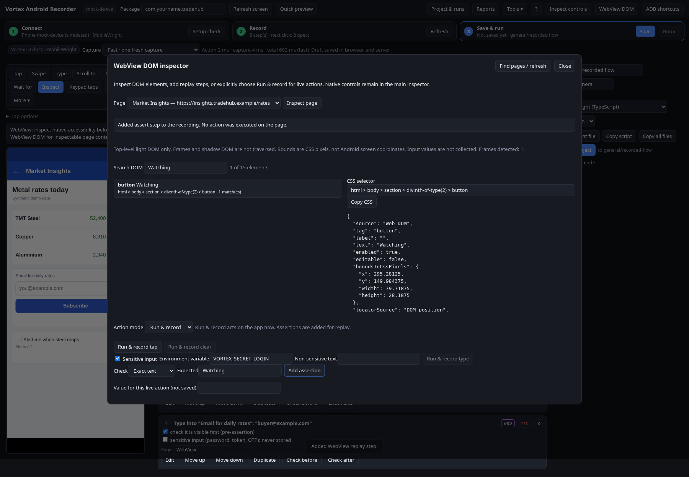

# Vortex Android Recorder

**V5.0.0-beta.2 · MobileWright 0.0.69**

Inspect Android screens, record actions, and generate TypeScript tests in Plain or Page Object Model (POM) format. V5 adds **live WebView recording**: select a DOM element, choose **Run & record**, and execute a tap, input replacement, or clear while adding the completed step to your recording.

V5 records live WebView actions on inspectable pages and can replay visual taps when Android exposes no usable locator. See the [V5 release notes](docs/V5_RELEASE.md) and [changelog](CHANGELOG.md).

## What you can do

- **Inspect native controls:** search text, accessibility labels, IDs and classes; review locator matches, bounds, and screen coordinates without tapping the phone.
- **Inspect WebView DOM:** discover and explicitly select an inspectable page, search its visible elements, and copy CSS selectors with actual match counts.
- **Record live WebView actions:** tap, replace input, or clear a field with **Run & record**. Keep **Add step only** for planning a flow without executing it.
- **Edit recordings:** reorder, duplicate and edit steps; insert before/after checks; recover browser and server drafts.
- **Generate and replay tests:** export Plain, POM or Both; reopen cases, run them, inspect reports and compare benchmark timings.
- **Manage device connections:** select a ready device, recover after reconnecting, or connect an already-paired, reachable Wi-Fi ADB endpoint.
- **Use ADB shortcuts:** run or record explicit argument arrays for navigation, screenshots, text, diagnostics and other device commands.

## Requirements

| Component | Requirement |
| --- | --- |
| Node.js | **22.18 or newer**; Node.js 24 recommended |
| Android platform-tools | `adb` available on `PATH` for physical-device work |
| Android device | USB debugging or an already-paired, reachable Wi-Fi debugging connection |
| Replay runner | **`@mobilewright/test@0.0.69`** installed in the output project |
| Mock WebView / integration tests | Playwright and Chromium; see [Verification](#verification) |

Replay uses the installed runner; Vortex does not download one on demand. Real WebView inspection and live recording require an app that exposes an inspectable page and the default Mobilecli hierarchy owner. A debuggable APK label alone does not establish DOM access.

## Get the V5 source

```bash
git clone https://github.com/panigrahi-shubham/Vortex-Android-CodeGen.git
cd Vortex-Android-CodeGen
npm ci
```

If you already have this branch checked out, run `npm ci` from the repository root.

## Start with an Android device

Create a separate output project and install the pinned runner. These commands work in PowerShell and Bash:

```bash
mkdir generated
cd generated
npm init -y
npm install --save-dev @mobilewright/test@0.0.69
cd ..
adb devices -l
```

Use the actual app package and a serial reported as `device` by ADB:

```bash
npm start -- --out generated --pkg com.example.yourapp --device YOUR_ADB_SERIAL --tree-source mobilecli
```

Open **http://localhost:4700**. On the phone, accept the debugging authorization prompt if it appears. If Vortex is already running, reuse its window; a duplicate start reports the occupied port without stopping the existing recorder.

If Mobilecli reports a different device ID, find it and supply it separately:

```bash
node generated/node_modules/mobilecli/index.js devices --platform android
npm start -- --out generated --pkg com.example.yourapp --device YOUR_ADB_SERIAL --mobilecli-device YOUR_MOBILECLI_ID --tree-source mobilecli
```

ADB commands continue to target the transport serial. The PowerShell launcher also supports `-Device` and `-MobilecliDevice`.

## Try the sample screens without a phone

```bash
npm run mock -- --out generated --no-open
```

Open **http://localhost:4700**. Native sample inspection works without a connected phone. To inspect the sample WebView or replay generated flows, prepare the runner and Chromium as described in [Verification](#verification), and start mock mode with those environment variables set.

In the sample app, inspect the **Market Insights** card and choose **Record tap** to open it. Then open **WebView DOM** to inspect its email field, Subscribe button and status text. Its Chromium DOM changes during live actions; the native sample screenshot remains a static image.

## Record a native flow

1. Start in **Inspect** mode. Search the captured controls or select a screen point; inspection alone sends no tap.
2. Review the locator and match count. Choose **Record tap**, **Record type**, **Add assertion**, or an explicit coordinate action.
3. Refresh after navigating outside Vortex. Prefer stable IDs and labels; positional and coordinate targets depend on layout.
4. Edit or reorder steps, add meaningful result checks, name the test and module, then save to the project.
5. Use **Project & runs** to reopen or replay the saved case and review its report.

**Fast capture** reads one fresh hierarchy and screenshot after an action. **Stable capture** compares consecutive hierarchies. **Quick preview** reads only a screenshot and invalidates old hit targets until a full refresh.

Drafts preserve recording steps, package, device identity and capture policy in browser storage and `.vortex/recording-draft.json`. Revision checks prevent conflicting tabs from silently overwriting each other. Save to the project for a durable recording history.

## Record a live WebView flow

1. Navigate to the intended WebView on the phone.
2. Open **WebView DOM → Find pages / refresh**, explicitly select a page, and choose **Inspect page**.
3. Search by text, label, DOM ID or CSS. Select an element and review its selector, match count, state and bounds.
4. Choose the action mode below, then add or execute the required step.
5. Save and replay using Plain, POM or Both. Review a destination or persisted-result assertion for each important action.

| Control | Acts on the app now? | Recording behavior |
| --- | --- | --- |
| Inspect / select / copy CSS | No | Reads the current DOM |
| Add step only | No | Appends a replay step |
| Run & record: tap, type, clear | Yes | Appends a confirmed completed step |
| Add assertion | No | Appends a check for replay |

Type replaces the field's value; clear empties it. Live actions use the supported MobileWright DOM primitives: `click()`, the native value setter, and input/change events. They do not provide trusted OS touch or keyboard events.



*The screenshot shows the synthetic sample. Its DOM state is live; its native image is static.*

### Sensitive input

Sensitive typing uses two separate values:

- **Environment variable:** the reference saved for future replay, such as `VORTEX_SECRET_WEB_INPUT`. Set that variable on the host before replay.
- **Value for this live action:** the one-time input sent during execution. Vortex excludes it from recorded input, action receipts and command-line arguments.

Password fields require an environment reference. DOM collection excludes field values, but an app can still echo input into visible text, URLs or screenshots. Review artifacts before sharing them.

### Recover an interrupted action

Use **Recover last action result** after losing a browser response. Vortex stores sanitized receipts in `<state-dir>/webview-actions/`; repeating the same request ID returns its result without dispatching the action again. Recovery inserts a completed step once and checks the matching app/device.

If the action completed but screen capture failed, keep the recorded step and inspect again. If its outcome is unknown, check the app and explicitly choose **I reviewed the outcome** before starting a new live request. Keep the state folder and pending browser receipt ID for recovery. This protection does not guarantee exactly-once business effects across different request IDs or retries inside the app.

### WebView limits

- Inspectable, visible **top-level light DOM** only. Frames and shadow DOM are not traversed.
- Up to **400 elements**, scanning at most **3000 candidates** per snapshot. Truncation is reported.
- Bounds are **CSS pixels**, independently of Android screenshot coordinates; there is no synchronized DOM overlay.
- Several pages require reliable native-to-page mapping before replay steps can be added. Ambiguous mappings remain inspection/copy-only.
- Native capture changes invalidate DOM targets. Live dispatch also rechecks page identity, unique matching, visibility, enabled/editable state and covering controls.
- Plain/POM exports guard the recorded page protocol, origin and path. Legacy export refuses DOM steps.
- No remote phone tunnel is created. A USB phone attached to another computer is not automatically visible to this host.

When no inspectable page is exposed, start with native text or IDs. For controls visible only in the screenshot, choose **Use visual taps**, click the control, then add a check for the expected result. See [WebView details](docs/WEBVIEW_AND_VISUAL.md).

## Devices, typing and ADB shortcuts

Open **Tools → Devices** to refresh the list, select a ready device, or recover the selected device after reconnecting it. Recovery keeps recorded steps, invalidates old targets and requires a fresh screen. It never silently selects another phone. Selection applies to the current session; startup defaults use `--device` and `--mobilecli-device`.

For an already-paired Wi-Fi device, enter its connection address, such as `192.168.1.40:5555`, choose **Connect**, then explicitly **Select** it. Pair on the Vortex host separately. Mock mode refuses physical connection commands.

**Quick type** appends printable ASCII to the already-focused field using ADB. It does not select or clear existing text. Its recorded value defaults to `VORTEX_SECRET_FOCUSED_TEXT`; screenshot-only feedback is the default. **Keypad taps** records explicit coordinates for keys absent from the hierarchy.

**ADB shortcuts** supports presets and explicit argument arrays, separate run/record modes, configurable timeouts, capture choices, command copying and binary downloads. Commands target the selected serial. Host shell syntax is not executed; Android pipelines require an explicit `shell sh -c` command. Raw ADB steps refuse simulated replay. Exported tests run outside Vortex must set `VORTEX_ADB_SERIAL` themselves.

For the existing StockPilot read-only home smoke example:

```bash
npm run smoke:stockpilot -- --device YOUR_ADB_SERIAL
```

See [recording details](docs/AUTOMATIC_RECORDING.md) and the [real-app acceptance checklist](docs/ACCEPTANCE_20.md).

## Save, export and replay

- **Plain:** one standalone TypeScript test.
- **POM:** page objects, fixtures, test data and tests.
- **Both:** both variants, with one discoverable default target to avoid running the flow twice.

Saving preserves hand-edited output and writes proposed replacements beside it as `.vortex-new`. Resolve pending file review before replay. Module/all runs reject mixed-app batches. Retries require an explicit repeat-safe confirmation because earlier successful actions can change app data again.

**Copy current file**, **Copy script** and **Copy all files** regenerate the current recording before copying. Reports distinguish passed, failed, empty, skipped, cancelled and load-error results. Benchmarks label simulated results and can repeat the selected flow's app changes.

The legacy single `.spec.ts` format remains available for supported older actions. Appium/Python execution is retired; old generated files remain user data. Earlier recordings still use schema version 1.

## Configuration

| Option | Environment variable | Default / purpose |
| --- | --- | --- |
| `--out` | `OUT_DIR` | `generated`; output/replay project |
| `--pkg` | `PKG` | `com.yourname.tradehub`; app package |
| `--device` | `DEVICE` | ADB serial; otherwise discover a single ready device |
| `--mobilecli-device` | `MOBILECLI_DEVICE` | Mobilecli ID when it differs from the serial |
| `--port` | `PORT` | `4700` |
| `--state-dir` | `VORTEX_STATE_DIR` | `.vortex`; drafts, receipts and run state |
| `--tree-source` | `TREE_SOURCE` | `auto`; use `mobilecli` for WebView workflows |
| `--tree-cmd` | `TREE_CMD` | `mobilecli dump ui`; custom commands disable DOM inspection/live actions |
| `--no-open` | — | Do not open the browser automatically |
| `--mock` | — | Use simulated devices and sample screens |

A failed installed Mobilecli request does not start competing uiautomator instrumentation. Explicit `--tree-source uiautomator` remains a native-only option when no other automation owner is active.

## Verification

From the repository root:

```bash
npm test
npm run typecheck
npm run doctor -- --out generated
```

For mock WebView inspection and the full integration suite, first install the runner in `generated` as above, then install Chromium:

```bash
node generated/node_modules/playwright/cli.js install chromium
```

Linux may also need browser system dependencies; CI uses `install --with-deps chromium`.

**PowerShell:**

```powershell
$runnerProject = (Resolve-Path .\generated).Path
$env:VORTEX_MOBILEWRIGHT_DIR = $runnerProject
$env:VORTEX_PLAYWRIGHT = $runnerProject
npm run test:integration
```

**Bash:**

```bash
export VORTEX_MOBILEWRIGHT_DIR="$PWD/generated"
export VORTEX_PLAYWRIGHT="$PWD/generated"
npm run test:integration
```

Keep these variables set when starting mock mode to use the WebView sample.

| V5 check | Observed result |
| --- | --- |
| `npm test` | 28 legacy checks and 81 Node tests passed |
| `npm run typecheck` | Passed |
| `npm run test:integration` | 29 tests passed, zero skips |
| Windows packaging / extracted startup | Passed on Linux |
| Physical-device and native Windows acceptance | Pending |

These results cover Linux simulation with the installed MobileWright runner and Chromium. CI is configured for Linux and Windows; hosted CI outcomes are separate from these local results. Historical evidence remains in [V2 notes](docs/V2_RELEASE.md), [V1 notes](docs/V1_RELEASE.md) and [earlier beta notes](docs/BETA_RELEASE.md).

## Build the Windows ZIP

```bash
npm run package:windows
```

Output:

```text
dist/vortex-android-recorder-5.0.0-beta.2-windows.zip
dist/vortex-android-recorder-5.0.0-beta.2-windows.zip.sha256
```

The ZIP includes the recorder, launchers, documentation and synthetic samples. Install Node.js, ADB and the replay runner separately. Building a ZIP or pushing this branch does not publish a GitHub release. The [published V2 archive](https://github.com/panigrahi-shubham/Vortex-Android-CodeGen/releases/tag/v2.0.0-beta.1) contains the earlier feature set.

More documentation: [Architecture](docs/ARCHITECTURE.md) · [Projects and modes](docs/PROJECTS_AND_MODES.md) · [Reports](docs/REPORTS_AND_DIAGNOSTICS.md) · [Benchmarks](docs/BENCHMARKS.md).
